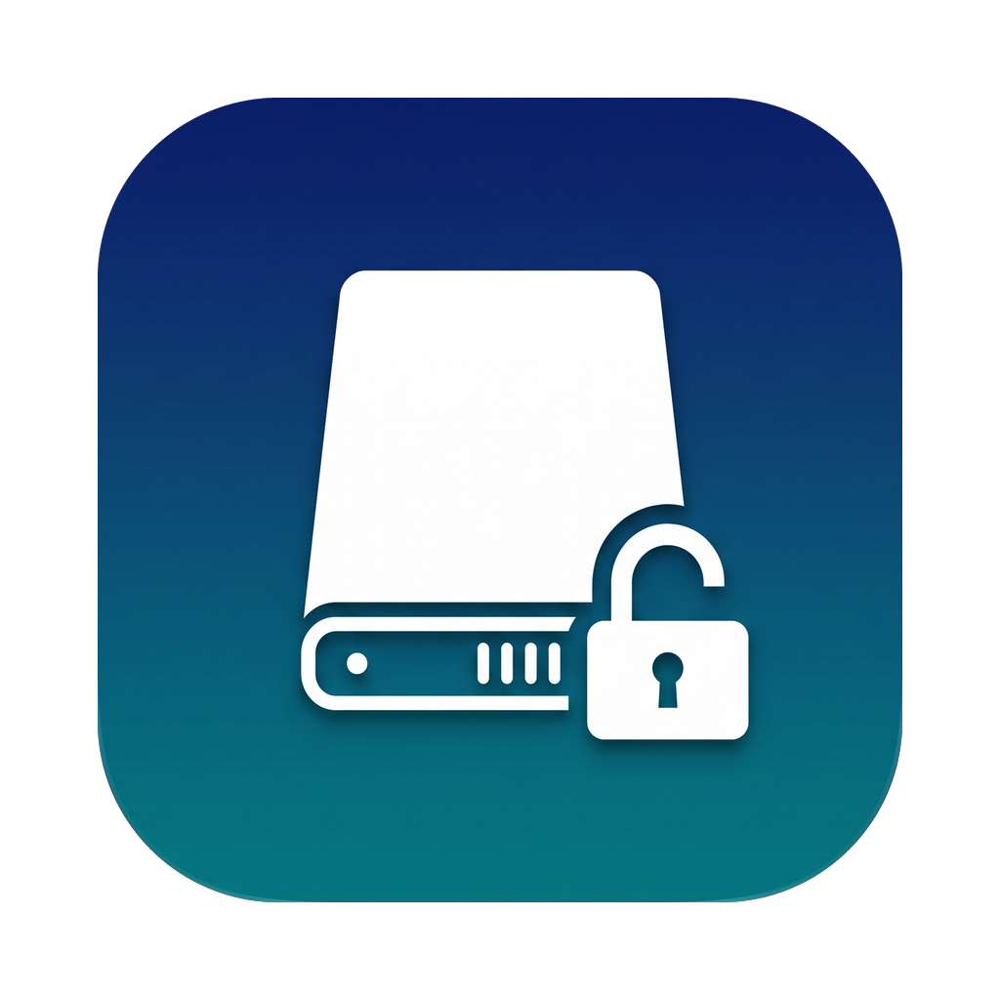

<p align="center"></p>

<h1 align="center">OpenNTFS</h1>

A free, open-source menu bar app that gives your Mac **read/write access to NTFS drives**, a free alternative to Paragon NTFS for Mac.

macOS can only read NTFS. OpenNTFS detects NTFS drives as you plug them in and remounts them read/write using the open-source [ntfs-3g](https://github.com/tuxera/ntfs-3g) driver on top of [macFUSE](https://macfuse.github.io).

## Features

- **Menu bar app**: every NTFS drive with its status (Read/Write, Read-only, Not mounted), free space bar, and device id.
- **Auto-mount read/write**: plug in a drive and it's writable. You can turn this off.
- **Safe fallback**: if Windows left the drive hibernated (Fast Startup), it stays mounted read-only and you get an explanation instead of a broken mount.
- **Repair**: clears the NTFS dirty flag (`ntfsfix -d`) so drives Windows didn't close cleanly mount again.
- **Rename** the volume label (`ntfslabel`).
- **Erase as NTFS** (`mkntfs`), with a confirmation step because it destroys data.
- **Open in Finder / Eject** in one click.
- **Launch at login**.
- **One-click dependency install** through Homebrew.

## Install

1. Install the drivers (free):
   ```sh
   brew install --cask macfuse
   brew install gromgit/fuse/ntfs-3g-mac
   ```
   On Apple Silicon, macFUSE's kernel extension has to be allowed once in **System Settings → Privacy & Security**. Depending on your macOS version this may also mean switching to Reduced Security in Recovery. See the [macFUSE docs](https://github.com/macfuse/macfuse/wiki/Getting-Started).
2. Build the app:
   ```sh
   Scripts/package_app.sh
   open build/OpenNTFS.app
   ```

Mount, repair, rename and erase run as root, so macOS asks for your admin password.

## Develop

```sh
swift build && swift test
swift run OpenNTFS    # Launch at login only works from the packaged .app
```

The code is in two files: `Sources/OpenNTFS/NTFS.swift` handles disk discovery and operations, and `OpenNTFSApp.swift` is the SwiftUI menu bar UI.

## Caveats

- ntfs-3g through FUSE is slower than Paragon's kernel driver. It's fine for copying files, but not tuned for heavy workloads.
- Always **Eject** before unplugging. Pulling a drive out mid-write can corrupt NTFS on any driver.
- Paragon, iBoysoft and other commercial NTFS drivers will claim drives before OpenNTFS does. Uninstall them if you want OpenNTFS to handle mounting.

## Icon

`Assets/logo-raw.png` was generated with fal (Nano Banana 2.1). `python3 Scripts/make_icon.py` turns it into `Assets/logo.png` and `Assets/Icon.icns`.

## License

MIT. ntfs-3g (GPL) and macFUSE are installed separately and called as external programs.
